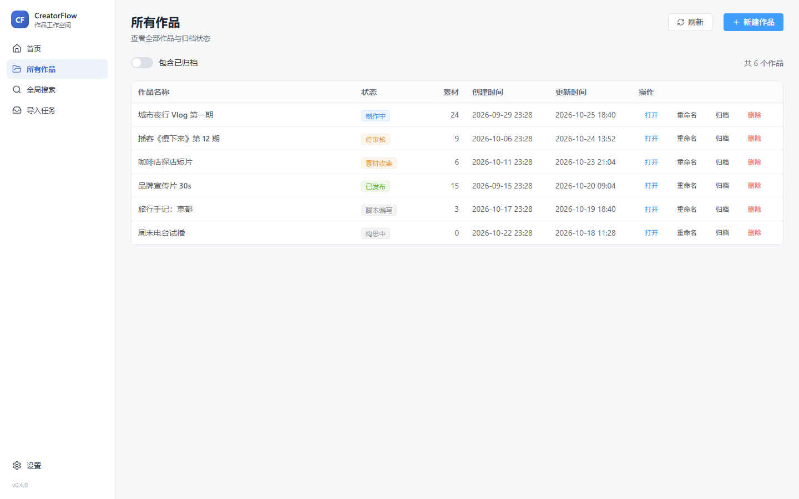
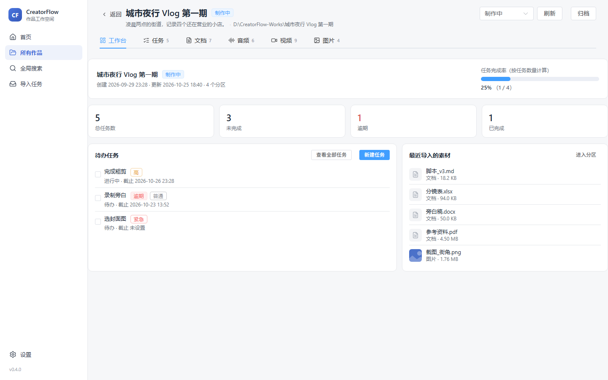
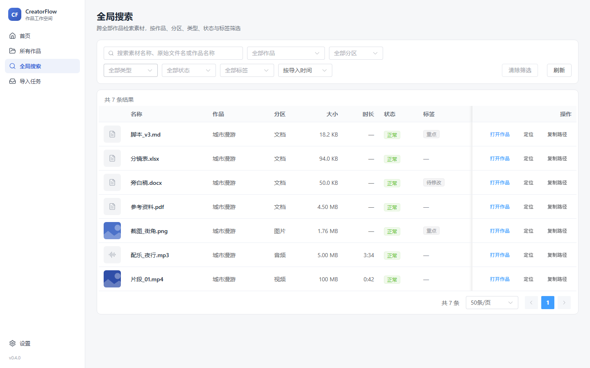

# CreatorFlow

以作品为中心的本地创作素材管理工具。每个作品对应磁盘上的一个真实目录，应用负责建立分区结构、记录素材索引、复制导入素材。作品文件始终以普通文件夹和文件的形式保存在你选择的位置，不依赖应用也能打开。


## 状态

当前版本 `0.4.0`。仅支持 Windows 10/11，macOS 与 Linux 尚未验证。

## 功能

- **作品**：新建时自动创建 `01_文档`、`02_音频`、`03_视频`、`04_图片` 四个分区和一个 `creatorflow.manifest.json`；支持重命名（同步改名磁盘目录）。
- **归档与恢复**：归档只改变应用内的状态，不移动、不删除目录，默认列表隐藏；恢复时回到归档前所处的状态。
- **删除到回收站**：首页卡片悬停或作品列表操作列都可以删除作品，整个作品文件夹移入系统回收站；素材可单独删除，文件同样先进回收站。应用内的记录即时消失，文件仍可从回收站还原。
- **素材导入**：文件对话框多选或直接把文件拖进窗口；按扩展名给出分区建议，导入前可逐个调整；只复制不移动，重名自动追加 ` (1)`，不覆盖已有文件。
- **导入队列**：固定 2 个后台工作线程（可通过设置调整为 1—4），任务排队执行并显示进度，可取消、可重试。复制写入临时文件，校验大小后改名；应用异常退出后，重启时按磁盘上的实际结果恢复任务。
- **搜索与筛选**：按名称搜索，按类型、分区、状态、标签筛选，按名称/导入时间/大小/时长排序，分页在 SQLite 中完成。
- **媒体信息与缩略图**：图片读取宽高并生成 480px 缩略图；音频读取时长、采样率、声道，存在内嵌封面时生成缩略图；MP4/MOV 读取时长、分辨率、帧率与编码。缩略图写入应用缓存目录。
- **标签**：为素材添加或移除标签，同名标签自动复用，可按标签筛选当前作品。
- **缺失文件恢复**：文件被移动或删除时标记为「文件缺失」并保留记录；可手动选择新位置重新关联，会比较大小与 SHA-256，内容不一致时需要二次确认。
- **作品工作台**：打开作品先看到工作台——任务完成率（按任务数量计算）、总任务/未完成/逾期、待办预览、最近导入的素材，四个分区通过顶部标签直达（工作台不再重复放置分区卡片）。
- **任务管理**：为作品建立任务清单，支持标题、描述、状态、优先级、截止时间；可完成/重开、调整顺序、按状态与优先级筛选，逾期任务会单独标注。
- **作品模板**：内置「通用视频」「直播切片」「播客/音频节目」三个模板，新建作品时预览并套用初始任务；可复制内置模板、编辑或删除自定义模板、设置默认模板。模板只影响新作品，修改模板不会改动已有作品的任务。
- **全局搜索**：侧栏「全局搜索」跨全部作品检索，匹配素材名、原始文件名与作品名，可按作品、分区、类型、状态、标签筛选并排序分页。
- **批量操作**：素材列表支持多选，可批量添加/移除标签、批量移入回收站，并逐项返回成功与失败结果。
- **数据库备份与恢复**：在设置页创建 SQLite 一致性快照，生成 JSON 清单并校验完整性与外键；恢复前先为当前数据库生成安全快照，失败自动回滚。备份只包含数据库，**不包含作品原文件**。
- **缓存管理**：显示缩略图缓存占用、文件数与容量上限（默认 2 GiB，可配 256 MiB—20 GiB），超限按最久未使用清理，可一键清理并由浏览时重新生成。
- **本地存储**：SQLite 保存索引，素材本体只存在于作品目录。删除采用「文件进回收站 + 记录软删除」，不做不可恢复的抹除。








## 技术栈

| 层 | 技术 |
| --- | --- |
| 桌面容器 | Tauri 2 |
| 前端 | Vue 3、TypeScript（strict）、Vite、Element Plus、Pinia、Vue Router |
| 后端 | Rust，按 commands / services / repositories / infrastructure 分层 |
| 数据库 | SQLite（rusqlite，bundled），逐版本 SQL 迁移 |
| 媒体处理 | image（图片尺寸与缩略图）、lofty（音频元数据）、mp4（MP4/MOV 解析）；ffmpeg 可选 |
| 日志 | tracing + tracing-appender，按天写入应用日志目录 |

## 快速开始

环境要求：

- Windows 10/11，WebView2 运行时（Windows 11 已内置）
- Node.js ≥ 22.12
- Rust stable（MSVC 工具链）
- Visual Studio Build Tools，勾选「使用 C++ 的桌面开发」

```bash
npm install
npm run tauri:dev
```

构建安装包：

```bash
npm run tauri:build
# 产物：src-tauri/target/release/bundle/nsis/CreatorFlow_0.4.0_x64-setup.exe
```

首次启动后，先在「设置」中选择作品根目录，再回首页新建作品。

### 视频封面（可选）

视频封面需要本机存在 `ffmpeg`，按以下顺序查找：环境变量 `CREATORFLOW_FFMPEG` 指定的路径 → 程序所在目录的 `ffmpeg.exe` → `PATH`。未找到时，MP4/MOV 仍可读取时长与分辨率，只是不生成封面；应用不会在运行时下载 ffmpeg。

## 目录结构

```text
src/                     前端
  components/            对话框、导入队列、状态标签
  constants/             分区、状态与媒体类型定义
  services/              Tauri 调用、事件订阅、缩略图 URL
  stores/                Pinia：作品、素材、导入、设置
  types/                 前后端共享的数据契约
  views/                 首页、作品页、素材页、设置页

src-tauri/               桌面端
  migrations/            SQL 迁移脚本（0001—0005）
  src/commands/          命令入口：参数校验与调度
  src/services/          作品、素材、任务、模板、导入队列、媒体探测、标签、备份与缓存
  src/repositories/      全部 SQL
  src/infrastructure/    数据库连接、文件系统、回收站、日志
  src/domain/            实体、查询参数、状态枚举
  src/errors/            统一错误码与提示文案
  tests/                 集成测试（临时目录 + 临时数据库）

docs/                    PRD、架构、数据库、测试说明与阶段报告
scripts/                 图标生成脚本
```

## 数据位置

| 内容 | 路径 |
| --- | --- |
| 作品文件 | `<作品根目录>/<作品名称>/` |
| 数据库 | `%APPDATA%\com.creatorflow.desktop\creatorflow.db` |
| 日志 | `%LOCALAPPDATA%\com.creatorflow.desktop\logs\` |
| 缩略图缓存 | `%LOCALAPPDATA%\com.creatorflow.desktop\thumbnails\` |
| 数据库备份 | `%APPDATA%\com.creatorflow.desktop\backups\`（可在设置中更改） |

数据库只保存索引和状态。在资源管理器里直接改动作品目录后，回到应用刷新即可看到状态变化；缩略图可随时删除，应用会按需重新生成。

## 实现要点

- **只复制，不移动**：导入总是写新文件，目标以 `create_new` 打开，从机制上排除覆盖；源文件只读。
- **有界队列**：固定数量的工作线程从队列取任务，默认并发 2、硬上限 4，不会为每个文件创建线程。
- **先临时文件再改名**：复制写入 `.part` 临时文件，校验字节数一致后再重命名为正式文件；取消或失败会清理临时文件。
- **可恢复的导入状态**：`import_jobs` 记录任务状态与目标路径。启动时检查未完成任务，目标存在且大小一致才算完成，否则标记失败并清理临时文件。
- **内容校验**：导入时对 512 MB 以内的文件计算 SHA-256，用于重新定位时判断是否同一文件。
- **元数据后台提取**：导入完成与启动时排队处理，单线程依次执行，避免解码图片或调用 ffmpeg 抢占 CPU；失败只影响媒体信息，不影响素材可用性。
- **路径限制**：所有相对路径拒绝 `..`、盘符和绝对路径；解析后再次校验结果是否仍在作品目录内。重新定位只接受作品目录内的文件。
- **删除可回退**：删除作品或素材时，真实文件交给系统回收站（`SHFileOperationW` + `FOF_ALLOWUNDO`），数据库只写 `deleted_at` 做软删除。顺序是先动磁盘再改库，回收站失败（文件被占用、权限不足）立即中止，不会出现「记录没了、文件还在」。
- **备份用 SQLite 在线备份接口**：WAL 模式下不直接复制 `.db`，而是用 `rusqlite::backup` 生成一致性快照；恢复时先校验、再快照当前库、最后在临时文件上换入，失败自动回滚。
- **批量校准存在性**：打开列表时按目录枚举文件名，而不是对每个素材单独 `stat`，一页素材的 I/O 次数与页大小无关。
- **任务与模板分离**：模板只保存「新建作品时的初始任务」，应用时复制成 `tasks` 记录；修改或删除模板不会回溯影响已有作品。
- **错误处理**：后端统一返回 `{ code, message, detail }`，界面只展示中文提示，技术细节写入日志。

## 开发命令

| 命令 | 说明 |
| --- | --- |
| `npm run tauri:dev` | 启动桌面应用（开发模式） |
| `npm run dev` | 只启动前端，用于查看界面（无桌面能力） |
| `npm run typecheck` | TypeScript 类型检查 |
| `npm run lint` | ESLint |
| `npm run test` | 前端单元测试（Vitest） |
| `npm run rust:fmt` | Rust 格式检查 |
| `npm run rust:clippy` | Rust Clippy（`-D warnings`） |
| `npm run rust:test` | Rust 单元测试与集成测试 |
| `npm run check` | 依次执行以上检查 |

## 已知限制

- 只支持 Windows；未提供 macOS 与 Linux 的构建配置。
- 删除只经过系统回收站，没有绕过回收站的永久删除；文件超过回收站容量时由系统接管并提示。
- 批量重命名尚未实现；批量标签与批量移入回收站已支持。
- 任务暂不与素材关联（例如「为某个镜头建任务」），关联表留到后续阶段。
- 搜索使用 `LIKE` 前缀通配，数据量很大时可迁移 FTS5（当前 5000 条素材实测仍在数十毫秒级）。
- 数据库备份不包含作品原文件与缩略图缓存，需要时请单独备份作品根目录。
- 自动备份与恢复失败的故障注入测试尚未实现。
- 视频元数据目前只解析 MP4/MOV；MKV、AVI 等显示「需要外部媒体工具」，视频封面依赖本机 ffmpeg。
- 音频不生成波形；封面仅取内嵌图片。
- 重新定位只支持作品目录内的文件，不支持引用作品外部路径。
- 搜索与筛选在「当前作品」内进行，暂无跨作品搜索入口。
- 批量标签、批量重命名、AI 能力、云同步不在当前阶段范围内。

## 许可证

[MIT](LICENSE)
