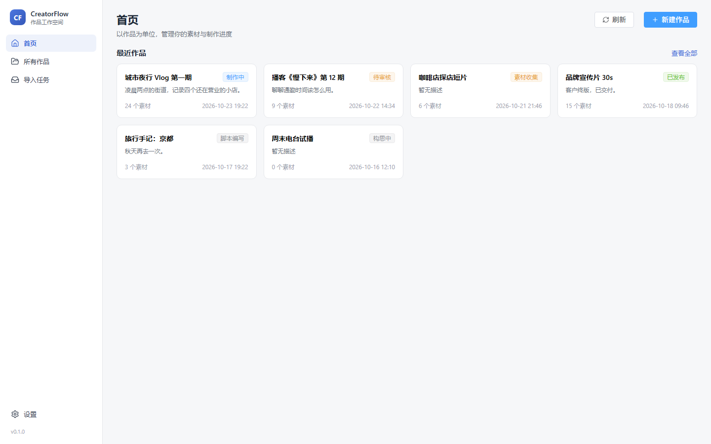
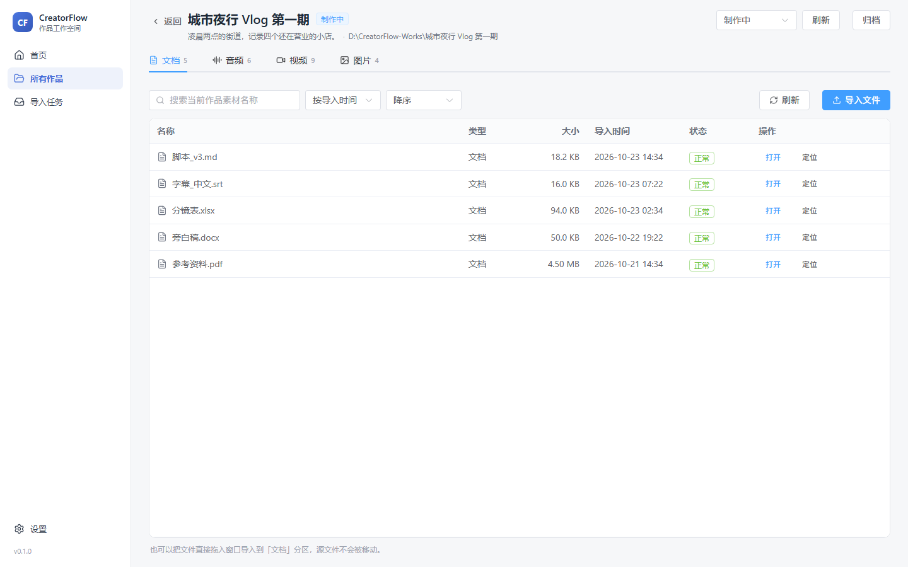

# CreatorFlow

以作品为中心的本地创作素材管理工具。每个作品对应磁盘上的一个真实目录，应用负责建立分区结构、记录素材索引、复制导入素材。作品文件始终以普通文件夹和文件的形式保存在你选择的位置，不依赖应用也能打开。



## 状态

当前版本 `0.1.0`，第一阶段已完成，可安装使用。仅支持 Windows 10/11，macOS 与 Linux 尚未验证。

## 功能

- **作品**：新建时自动创建 `01_文档`、`02_音频`、`03_视频`、`04_图片` 四个分区和一个 `creatorflow.manifest.json`；支持重命名（同步改名磁盘目录）与归档（只改状态，不动文件）。
- **素材导入**：文件对话框多选或直接把文件拖进窗口；按扩展名给出分区建议，导入前可逐个调整；只复制不移动，重名自动追加 ` (1)`，不覆盖已有文件。
- **导入任务**：后台线程执行并显示进度，可取消、可重试。应用异常退出后，重启时按磁盘上的实际结果恢复任务状态。
- **素材浏览**：分区切换、按名称搜索、按名称/大小/导入时间排序；图片可预览；可用默认程序打开或在资源管理器中定位。文件被移走或删除时标记为「文件缺失」，记录保留。
- **本地存储**：SQLite 保存索引，素材本体只存在于作品目录，数据库可直接用文件资源管理器备份。



## 技术栈

| 层 | 技术 |
| --- | --- |
| 桌面容器 | Tauri 2 |
| 前端 | Vue 3、TypeScript（strict）、Vite、Element Plus、Pinia、Vue Router |
| 后端 | Rust，按 commands / services / repositories / infrastructure 分层 |
| 数据库 | SQLite（rusqlite，bundled），逐版本 SQL 迁移 |
| 日志 | tracing + tracing-appender，按天写入应用日志目录 |

## 快速开始

环境要求：

- Windows 10/11，WebView2 运行时（Windows 11 已内置）
- Node.js ≥ 22.12
- Rust stable（MSVC 工具链）
- Visual Studio Build Tools，勾选「使用 C++ 的桌面开发」

```bash
npm install
npm run tauri:dev
```

构建安装包：

```bash
npm run tauri:build
# 产物：src-tauri/target/release/bundle/nsis/CreatorFlow_0.1.0_x64-setup.exe
```

首次启动后，先在「设置」中选择作品根目录，再回首页新建作品。

## 目录结构

```text
src/                     前端
  components/            对话框、导入队列、状态标签
  constants/             分区定义与状态文案
  services/              Tauri 调用与事件订阅
  stores/                Pinia：作品、素材、导入、设置
  types/                 前后端共享的数据契约
  views/                 首页、作品页、素材页、设置页

src-tauri/               桌面端
  migrations/            SQL 迁移脚本
  src/commands/          命令入口：参数校验与调度
  src/services/          业务规则：作品、素材、导入、设置
  src/repositories/      全部 SQL
  src/infrastructure/    数据库连接、文件系统、日志
  src/domain/            实体与状态枚举
  src/errors/            统一错误码与提示文案
  tests/                 集成测试（临时目录 + 临时数据库）

docs/                    PRD、架构、数据库、测试说明
scripts/                 图标生成脚本
```

## 数据位置

| 内容 | 路径 |
| --- | --- |
| 作品文件 | `<作品根目录>/<作品名称>/` |
| 数据库 | `%APPDATA%\com.creatorflow.desktop\creatorflow.db` |
| 日志 | `%LOCALAPPDATA%\com.creatorflow.desktop\logs\` |

数据库只保存索引和状态。在资源管理器里直接改动作品目录后，回到应用刷新即可看到状态变化。

## 实现要点

- **只复制，不移动**：导入总是写新文件，目标以 `create_new` 打开，从机制上排除覆盖；源文件只读。
- **先临时文件再改名**：复制写入 `.part` 临时文件，校验字节数一致后再重命名为正式文件，中途失败不会留下半个可见文件。
- **可恢复的导入状态**：`import_jobs` 记录任务状态与目标路径。启动时检查未完成任务，目标存在且大小一致才算完成，否则标记失败并清理临时文件。
- **路径限制**：所有相对路径拒绝 `..`、盘符和绝对路径；解析后再次校验结果是否仍在作品目录内。
- **错误处理**：后端统一返回 `{ code, message, detail }`，界面只展示中文提示，技术细节写入日志。

## 开发命令

| 命令 | 说明 |
| --- | --- |
| `npm run tauri:dev` | 启动桌面应用（开发模式） |
| `npm run dev` | 只启动前端，用于查看界面（无桌面能力） |
| `npm run typecheck` | TypeScript 类型检查 |
| `npm run lint` | ESLint |
| `npm run test` | 前端单元测试（Vitest） |
| `npm run rust:fmt` | Rust 格式检查 |
| `npm run rust:clippy` | Rust Clippy（`-D warnings`） |
| `npm run rust:test` | Rust 单元测试与集成测试 |
| `npm run check` | 依次执行以上检查 |

## 已知限制

- 只支持 Windows；未提供 macOS 与 Linux 的构建配置。
- 不提供永久删除，只有归档和「文件缺失」标记。
- 不读取媒体元数据，不生成视频缩略图与音频波形；图片预览上限 24 MB。
- 批量导入时每个文件一个后台线程，暂无并发上限。
- AI 能力、节点式工作流、云同步不在当前阶段范围内。

## 许可证

[MIT](LICENSE)
